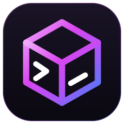

<div align="center">

```
██████╗ ███████╗██╗   ██╗███████╗███████╗████████╗██╗   ██╗██████╗
██╔══██╗██╔════╝██║   ██║██╔════╝██╔════╝╚══██╔══╝██║   ██║██╔══██╗
██║  ██║█████╗  ██║   ██║███████╗█████╗     ██║   ██║   ██║██████╔╝
██║  ██║██╔══╝  ╚██╗ ██╔╝╚════██║██╔══╝     ██║   ██║   ██║██╔═══╝
██████╔╝███████╗ ╚████╔╝ ███████║███████╗   ██║   ╚██████╔╝██║
╚═════╝ ╚══════╝  ╚═══╝  ╚══════╝╚══════╝   ╚═╝    ╚═════╝ ╚═╝
```



# TIPACK · DEVSETUP IF

**Alternatif Ninite yang modern: pilih aplikasi, salin satu perintah, selesai. Plus Doctor auto-fix, Tune-Up laptop lama dan Debloat.**
Installer, tune-up & debloat interaktif di terminal untuk **Windows, macOS & Linux** (x64 dan ARM64, termasuk Termux di Android): wizard preferensi, **245 aplikasi** (tools IT dan software sehari-hari: browser, chat, media, office, keamanan, cloud, gaming, AI) dengan penjelasan dan rekomendasi, dan yang sudah terpasang otomatis dilewati. Tersedia juga sebagai **aplikasi GUI** (`.msi`, `.dmg`, `.deb`, `.rpm`, AppImage).

[](https://tipack.kousozo.tech)
[](https://tipack.kousozo.tech/katalog)
[](LICENSE)
[](https://github.com/fk0u/tipack/actions/workflows/test.yml)


[Mulai cepat](#-mulai-cepat) · [Fitur](#-fitur) · [Rilis](https://github.com/fk0u/tipack/releases/latest) · [Dokumentasi](docs/README.md) · [Katalog](docs/katalog.md) · [FAQ](docs/troubleshooting.md) · [Kontribusi](CONTRIBUTING.md)

</div>

---

## 🤔 Kenapa TIPACK?

Setiap awal semester selalu ada yang sama: Python tidak masuk PATH, `g++` tidak dikenali, XAMPP bentrok port, WSL tidak jalan, atau bingung pilih WinRAR atau 7-Zip. TIPACK menyelesaikan semua itu di terminal:

- **Kamu memilih, TIPACK yang mengerjakan.** Setiap pilihan punya kotak penjelasan dan label rekomendasi, jadi pemula tahu apa yang dipasang dan kenapa.
- **Tidak dobel.** Sebelum install, setiap aplikasi dicek dulu. Yang sudah ada ditandai ✓ dan dilewati.
- **Sumber resmi.** Semua lewat package manager resmi (winget, Homebrew, apt, dnf, pacman, zypper, apk, Flathub) atau installer resmi vendornya.
- **Bisa diaudit.** Semua kode ada di repo ini. Baca dulu sebelum menjalankan.

## 🛒 Pilih aplikasi ala Ninite

Buka **https://tipack.kousozo.tech/#pilih**, centang aplikasinya (lengkap dengan logo asli), lalu salin satu perintah. Contoh yang dihasilkan:

```powershell
$env:TIPACK_APPS="chrome,vscode,discord,spotify,vlc"; irm https://tipack.kousozo.tech/install.ps1 | iex
```
```bash
curl -fsSL https://tipack.kousozo.tech/install.sh | bash -s -- --install chrome,vscode,discord,spotify,vlc
```

Pilihan bisa dibagikan sebagai link atau diunduh sebagai `tipack.json` untuk satu lab atau kelas.

## 🖱️ Aplikasi GUI

Unduh dari [rilis terbaru](https://github.com/fk0u/tipack/releases/latest). Menunya: pasang aplikasi, profil, konfigurasi `tipack.json`, Doctor dan laporan masalah, dengan progres tiap aplikasi tampil langsung. Detail di [docs/gui.md](docs/gui.md).

## 🚀 Mulai cepat

**Windows 10/11.** Buka **PowerShell** atau **Terminal** (`Win` + `X`), lalu:

```powershell
irm https://tipack.kousozo.tech/install.ps1 | iex
```

**macOS dan Linux.** Buka **Terminal**, lalu jalankan perintah ini (OS dan distro terdeteksi otomatis):

```bash
curl -fsSL https://tipack.kousozo.tech/install.sh | bash
```

Tidak ada `curl` (distro minimal)? Pakai `wget`:

```bash
wget -qO- https://tipack.kousozo.tech/install.sh | bash
```

> [!TIP]
> Untuk laptop baru, pilih **🧙 Wizard Preferensi** di menu utama. Butuh sekitar 5 menit untuk menjawab, lalu tinggal ditinggal sampai selesai.

> [!IMPORTANT]
> Di Linux jalankan sebagai **user biasa**, jangan pakai `sudo` di depan perintah. Password sudo diminta sekali saat instalasi dimulai.

Mau membaca script-nya dulu? Lihat [Instalasi manual](docs/instalasi.md#instalasi-manual).

## ✨ Fitur

| | Fitur | Keterangan |
|---|---|---|
| 🧙 | **Wizard preferensi** | 16–20 pertanyaan (tergantung OS): WinRAR vs 7-Zip, mau WSL atau tidak, pengganti WSA, browser, editor, IDE, bahasa, web server, database, container/VM, dan lainnya. Esc untuk kembali ke pertanyaan sebelumnya. |
| 📦 | **11 profil siap pakai** | `starter`, `cpp`, `java`, `web`, `mobile`, `data`, `net`, `devops`, `game`, `design`, `tech`. Bisa dari menu atau parameter `--preset`. |
| 🔍 | **Deteksi otomatis** | Dicek lewat `winget export`, `brew list`, database paket distro, `flatpak list`, perintah di PATH, dan folder instalasi. |
| 🗂 | **Pilih manual** | Jelajahi per kategori (17 kategori) atau satu daftar panjang berisi semua aplikasi. |
| 🛒 | **Keranjang pintar** | Ditinjau sebelum install. Ada peringatan konflik (Node vs NVM, XAMPP vs MySQL, Docker vs OrbStack) dan peringatan paket berat kalau RAM kecil. |
| 📊 | **Progress yang jelas** | Progress bar, spinner + timer per aplikasi, ringkasan akhir, log lengkap, dan link untuk aplikasi yang harus diinstall manual. |
| 🧩 | **Ekstensi VS Code** | Pemilih 24–30 ekstensi penting dengan tooltip. Yang direkomendasikan sudah dicentang. |
| 🔑 | **Git & SSH ke GitHub** | Atur `user.name`/`email`, buat SSH key ed25519, copy ke clipboard, buka halaman GitHub, `gh auth login`. |
| ⚙️ | **Tweak OS untuk developer** | Tampilkan ekstensi dan file tersembunyi, Long Paths, Developer Mode, batas inotify, grup docker/dialout, dark mode, dan lainnya. |
| 🚀 | **Tune-Up & optimasi** | Bersihkan file sampah & cache (TEMP, Windows Update, Homebrew, Xcode, cache paket Linux), efek visual ringan, power plan, matikan hibernasi, TRIM/defrag, SFC/DISM, **zram** & **earlyoom** di Linux, snapshot Time Machine di macOS. Ukuran ditampilkan sebelum dihapus. |
| ⚡ | **Kelola startup** (Windows) | Nonaktifkan aplikasi yang ikut jalan saat booting, dengan cara yang sama seperti Task Manager. Bisa diaktifkan lagi kapan saja. |
| 🧹 | **Debloat** | Windows: hapus aplikasi bawaan/promo, matikan iklan Start, Copilot, Recall, Widgets, telemetri, Bing (restore point otomatis). macOS: GarageBand/iMovie/iWork. Linux: lepas Snap, telemetri Ubuntu, layanan tak terpakai. |
| 🩺 | **Doctor (auto-fix)** | Diagnosa winget/sumber paket rusak, apt/dpkg terkunci atau terputus, lock pacman, keyring Arch, Homebrew & PATH, Rosetta, ExecutionPolicy, Long Paths, jam sistem, disk penuh, dan aplikasi yang gagal kemarin. Lalu perbaiki dengan izinmu. |
| 🐞 | **Laporkan masalah** | Log disensor (nama user, hostname, email, IP publik, token), disalin ke clipboard, lalu form GitHub Issue terbuka dengan info sistem terisi. |
| 📄 | **`tipack.json`** | `-Config` / `--config` (file atau URL) untuk menyamakan isi banyak laptop. |
| ⟳ | **Update semua** | `winget upgrade --all`, `brew upgrade`, atau upgrade paket distro + Flatpak. |

### Dukungan OS

| OS | Mesin | Catatan |
|---|---|---|
| **Windows 10 (1809+) / 11** | winget, WSL, Windows Optional Features | Jalankan sebagai Administrator untuk WSL dan fitur Windows. |
| **macOS 12+** (Apple Silicon & Intel) | Homebrew (formula + cask) | Xcode CLT dan Homebrew dipasang otomatis kalau belum ada. |
| **Debian, Ubuntu, Mint, Pop!_OS, Kali, Zorin** | apt | VS Code dari repo resmi Microsoft, Chrome dari paket resmi Google. |
| **Fedora, RHEL, Rocky, Alma, Nobara** | dnf | |
| **Arch, Manjaro, EndeavourOS, CachyOS, Garuda** | pacman + AUR | `yay` dipasang otomatis kalau perlu AUR. |
| **openSUSE Tumbleweed / Leap** | zypper | |
| **Alpine** | apk | |
| **Fedora Silverblue/Kinoite, Bazzite, Bluefin, SteamOS, NixOS** (immutable) | Flatpak + script di home | Sistem tidak diubah; tool CLI disarankan di dalam distrobox. |
| **Android** | via **[Andronix](https://andronix.app)** (disarankan) atau Termux | Andronix memasang Ubuntu/Debian/Arch di Android, lalu TIPACK berjalan seperti Linux biasa. Termux murni hanya punya tool CLI dasar. |
| **ChromeOS (Crostini), Raspberry Pi OS** | apt | Terdeteksi otomatis. |
| **Distro lain** (Void, Solus, Gentoo, ...) | Flatpak + script resmi | Paket native tidak didukung; aplikasi GUI tetap bisa lewat Flathub. |

**Arsitektur:** x64, **ARM64** (Windows on Snapdragon, Apple Silicon, Raspberry Pi, ARM Linux) dan Windows x86 (32-bit, katalog terbatas). Semua kombinasi utama diuji otomatis di [GitHub Actions](https://github.com/fk0u/tipack/actions/workflows/test.yml).

Detail Linux: [docs/linux.md](docs/linux.md).

## 🖥️ Tampilan

```
▓▒░ DEVSETUP IF │ Wizard │ Pertanyaan 2/20  ●●○○○○○○○○○○○○○○○○○○   │ Keranjang: 6 item
────────────────────────────────────────────────────────────────────────────────
 Aplikasi kompres/ekstrak arsip?
 7-Zip gratis dan open source (rekomendasi). WinRAR kalau perlu MEMBUAT .rar.

 ► ● 7-Zip                                  ♦ rekomendasi
   ○ WinRAR
   ○ NanaZip
   ○ PeaZip
   ○ Lewati / tidak perlu

┌─ 7-Zip ──────────────────────────────────────────────────────────────────────┐
│ Gratis dan open source. Bisa buka zip/rar/7z/iso/tar. Paling aman dan ringan. │
│ Status: belum terpasang.  |  winget: 7zip.7zip                                │
└──────────────────────────────────────────────────────────────────────────────┘
 ↑↓ gerak  Enter pilih & lanjut  Esc kembali
```

### Tombol

| Tombol | Fungsi |
|---|---|
| `↑` `↓` atau `j` `k` | gerak |
| `PgUp` `PgDn` `Home` `End` | lompat |
| `Spasi` | centang / hapus centang |
| `a` / `n` / `r` | centang semua / kosongkan / hanya rekomendasi |
| `Enter` | pilih / lanjut |
| `Esc`, `Backspace` (atau `q` di macOS/Linux) | kembali |

## 🧭 Mode tanpa menu

Pasang satu profil langsung, tanpa menu interaktif (berguna untuk lab atau setup massal):

```powershell
# Windows
powershell -ExecutionPolicy Bypass -File setup.ps1 -Preset starter
```
```bash
# macOS / Linux
bash setup.sh --preset starter
```

Atau pasang aplikasi tertentu saja (key dari [katalog](docs/katalog.md)):

```powershell
setup.ps1 -Install git,vscode,7zip        # Windows
```
```bash
bash setup.sh --install git,vscode,python # macOS / Linux
```

Exit code `0` = berhasil, `3` = ada yang gagal. Tambahkan `-NoAnim` / `--no-anim` untuk mematikan animasi. Daftar preset dan isinya ada di [docs/katalog.md](docs/katalog.md#profil).

## 📚 Dokumentasi

| Dokumen | Isi |
|---|---|
| [Instalasi](docs/instalasi.md) | Syarat, perintah satu baris, instalasi manual, parameter, lokasi file, cara menghapus. |
| [Panduan penggunaan](docs/penggunaan.md) | Setiap menu dijelaskan: wizard, profil, keranjang, ekstensi VS Code, Git/SSH, tweak, update. |
| [Linux](docs/linux.md) | Deteksi distro, urutan metode install, AUR, Flatpak, root/sudo, WSL. |
| [Katalog aplikasi](docs/katalog.md) | Semua 188 aplikasi per kategori dan isi setiap profil (dibuat otomatis). |
| [Troubleshooting & FAQ](docs/troubleshooting.md) | Masalah umum per OS dan solusinya. |
| [Keamanan](docs/keamanan.md) | Apa yang dilakukan script, sumber paket, hak akses, cara audit. |
| [Arsitektur & kontribusi](docs/arsitektur.md) | Struktur repo, format katalog, cara menambah aplikasi, pengujian. |
| [Aplikasi GUI](docs/gui.md) | Unduh, fitur, cara kerja, build sendiri. |
| [SignPath](docs/signpath.md) | Tanda tangan digital installer Windows. |
| [Website](docs/website.md) | Situs tipack.kousozo.tech: halaman, sistem optimisasi, build katalog, deploy. |
| [CHANGELOG](CHANGELOG.md) | Riwayat versi. |
| [Notulensi pengembangan](docs/notulensi.md) | Kronologi, keputusan teknis, masalah & akar masalahnya, hasil uji, tindak lanjut. |

## 🗂️ Struktur repo

```
tipack/
├── windows/            setup.ps1 (installer Windows) + JALANKAN.bat
├── macos/              setup.sh (installer macOS, juga sumber mesin TUI untuk Linux)
├── linux/              setup.sh (hasil rakitan, jangan diedit langsung)
│   └── src/            linux-parts.sh, build.sh, test-distro.sh
├── web/                landing page, katalog, perf.js, bootstrap install.sh/ps1, build-catalog.py
├── docs/               dokumentasi
├── CONTRIBUTING.md
└── LICENSE             MIT
```

## 🤝 Kontribusi

Ada aplikasi yang kurang, ID paket yang salah, atau distro yang belum didukung? Kontribusi sangat diterima. Untuk menambah satu aplikasi biasanya cukup **satu baris** di katalog. Baca [CONTRIBUTING.md](CONTRIBUTING.md).

## ⚠️ Disclaimer

TIPACK memasang software pihak ketiga dari sumber resminya. Setiap aplikasi tunduk pada lisensinya masing-masing (misalnya WinRAR berlisensi trial, Microsoft 365 butuh akun). Gunakan tool keamanan (Nmap, Wireshark, Burp Suite) hanya pada jaringan dan sistem yang kamu miliki atau sudah diizinkan.

## 📄 Lisensi

[MIT](LICENSE) © 2026 KouMac (fk0u)
